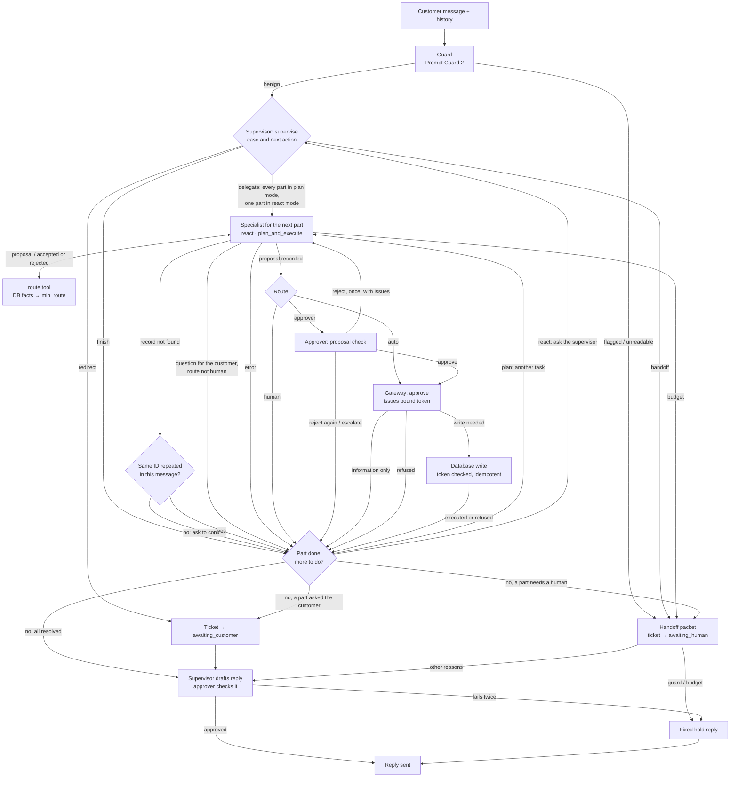

# Multi-agent support system with RAG policy (S3)

S3 is the multi-agent architecture of the project: a **supervisor**, two **specialists** and an
**approver**, with a deterministic **gateway** between the agents and every write. Policy is
retrieved with RAG. It runs beside the single-agent system (S1) in the same codebase, and it
uses the same database, LLM wrapper, tracing and policy tool.

The core rule: **LLMs propose, deterministic code disposes.** Agents only read, propose, review
and write text. Whether anything is executed is decided by code: a rule engine sets the minimum
route for each proposal, approval tokens are bound to one ticket, order, amount and items, and the
write endpoint refuses anything without a valid token.

## Run it

All commands run from the repository root. One-time setup (Python 3.11–3.13, uv, Docker):

```bash
uv venv --python 3.12 .venv
uv pip install --python .venv/bin/python -e ".[dev,rag,demo]"
cp .env.example .env          # then set GROQ_API_KEY
```

If `uv` is not found, install it with `brew install uv`. A uv-created venv has no `pip`.

### 1. Database

```bash
docker compose up -d --wait postgres
.venv/bin/python scripts/seed_backend.py       # fictional orders, shipments, payments, returns
```

### 2. Backend: the multi-agent API

```bash
.venv/bin/uvicorn support_ops.api_multi:app --reload --host 127.0.0.1 --port 8001
```

Wait for `multi-agent ... policy mode 'rag' ready` in the log: the embedding and reranker models
load once at startup. Swagger UI is at <http://127.0.0.1:8001/docs>. The single-agent API
(`support_ops.api:app`) uses port 8000, so both can run together.

| Endpoint | What it does |
|---|---|
| `POST /chat` | One customer turn; returns the reply, outcome and full trace. |
| `POST /chat/stream` | The same turn as Server-Sent Events: one `trace` event per step, then `result` (or `error`). Runs on a pool of 4 workers (a fifth concurrent stream gets `503`); a client that disconnects cancels its ticket at the next step. |
| `GET /info` | Config in use: policy mode, corpus, models, default strategy and orchestration. |
| `GET /health` | Liveness only; does not check the database or Groq. |

Request body:

```json
{
  "customer_message": "One of the two Terra bottles in ORD-2026-00031 arrived dented. Can I get a refund for it?",
  "orchestration": "react",
  "strategy": "react",
  "ticket_id": "TKT-LOCAL-001",
  "history": []
}
```

`orchestration` (the supervisor) and `strategy` (the specialists) are each `react` or `plan_and_execute`.
Defaults: `strategy` from `agent.strategy`; `orchestration` from `multi_agent.orchestration`, else the same
as `strategy`.
The API is stateless: to continue a ticket, send the `history` array from the previous response. It is
trimmed to the newest exchanges that fit the 50-turn limit. Streaming, cancellation and history
trimming reuse the single-agent API's helpers (`helpers/workers.py`, `helpers/cancellation.py`, `api.py`).

### 3. Frontend: the Streamlit page

In a second terminal, with the API running:

```bash
.venv/bin/streamlit run scripts/demo_multi_agent.py
```

It opens at <http://localhost:8501>. Pick the supervisor's orchestration and the specialists' strategy in the sidebar and write as the
customer. While the ticket runs, the page shows each step live: the supervisor's decisions, the specialist's tool calls
and retrieved clauses, the route decision, the approver's verdicts, the
database write and any handoff. Each reply has an **Outcome** tab with the proposal, the audit log and
the handoff packet. Set `SUPPORT_OPS_MULTI_API` to point the page at another API address.

Messages to try (return windows count from today, so use orders delivered in the last 30 days):

| Message | Expected |
|---|---|
| `Where is my order ORD-2026-00002?` | Resolved; reply built from the shipment facts |
| `One of the two Terra bottles in ORD-2026-00031 arrived dented. Can I get a refund for it?` | S$32 refund → approver → executed |
| `I'd like a refund for the Flex Training Mat from ORD-2026-00045. It's unused and still in its original packaging.` | S$48 refund or return → approver → executed |
| `My headphones from ORD-2026-00041 stopped working. I want a full refund.` | Awaiting a human, with a handoff packet |
| `I want to speak to a human about ORD-2026-00031.` | Handed off by the supervisor |

### 4. Tests

```bash
.venv/bin/python -m pytest -q
```

The suite uses a scripted LLM (`ScriptedLLM`) and a fake retriever, so it needs no API key,
database or model download.

## Architecture

The diagrams are also in [`multi-agent-flow.drawio`](multi-agent-flow.drawio) (open it with
[diagrams.net](https://app.diagrams.net) or the VS Code Draw.io extension). Page 1 is the ticket flow,
page 2 the components.

### Two settings: how the supervisor orchestrates, and how the specialists work

"ReAct" and "plan-and-execute" describe **how steps are chosen**, and S3 chooses steps at two levels.
Each level has its own setting, so all four combinations can be compared:

| Setting | `plan_and_execute` | `react` |
|---|---|---|
| **`orchestration`**, the supervisor: which specialist handles which part | The supervisor's one decision lists every part up front (`tasks`, one per specialist); the graph runs them in order and never asks again | The supervisor decides one step at a time (`supervise` node): delegate a part to a specialist, see how it ended, delegate the next or finish |
| **`strategy`**, the specialists: which tools to call | List all read and policy calls as JSON, run them, then propose; replan only after an invalid plan or a proposal the rules reject | One tool call per turn, each chosen after seeing the last result |

Set them per request (`orchestration`, `strategy`), in the Streamlit sidebar, or in config
(`multi_agent.orchestration`, `agent.strategy`). When `orchestration` is not set it follows `strategy`,
so the default pairs are **plan_and_execute + plan_and_execute** and **react + react**.

| | Plan-and-execute orchestration | ReAct orchestration |
|---|---|---|
| Supervisor LLM calls | one decision + reply | one per step (each delegation, then finish) + reply |
| Can react to a result | no: the plan is fixed at the first decision | yes: e.g. the order specialist finds the item damaged, so the refund specialist is called |
| Step limit | one decision | `max_orchestration_steps` (default 4) |
| Same specialist twice | no | yes, unless it already executed a write on the ticket (code refuses: one ticket needs one write per specialist, so a second is more likely a repeat) |

### Decisions in code

The LangGraph `StateGraph` has a fixed set of nodes (guard → supervise → specialist → decide → execute →
handoff → reply). Each node returns a `next` value that a conditional edge follows, and that
value is always set by Python code in the node. The LLMs shape the path only through **typed outputs that
code reads**:

| Node | LLM output | What code decides from it |
|---|---|---|
| `guard` | Prompt Guard 2 score per chunk | above `guard.threshold`, or unreadable → handoff; else supervise |
| `supervise` | `SupervisorDecision`: `thought`, `action` (`delegate`, `handoff`, `redirect`, `finish`), `tasks`, `reason`, and on the first decision the `case` | The graph follows the action. It only refuses a delegation to a specialist that already wrote, and hands off a `finish` with no part done or a decision that stays unreadable. There is no triage code: the supervisor LLM decides who handles what and when a person is needed |
| `specialist` | `Proposal` through the `route` tool | `RouteTool` rejects a route looser than `min_route`; then: missing record → ask or hand off; question for the customer → end the part; else decide |
| `decide` | approver verdict (only on the `approver` route) | `human` → the part needs a human; reject → back to the specialist once; escalate or a second reject → the part needs a human; approve or `auto` → gateway token |
| `execute` | none | the backend write checks the token and the database; refused → the part needs a human |
| end of a part | none | plan: another task → its specialist; react: back to `supervise`. At the end the strictest part decides: any human → handoff, any question → `awaiting_customer`, else resolved |
| `handoff` | none | builds the packet, ticket → `awaiting_human` |
| `reply` | the reply draft (supervisor) and the approver's reply check | a draft failing review twice → fixed hold reply and handoff |

So the supervisor LLM **works out what the customer needs**, chooses **which specialists handle which part** (all at
once, or one step at a time), decides **when a person or a redirect is needed**, and **words the reply**. Whether anything is executed, needs an approver or goes
to a person comes from `src/support_ops/policy/rules/rules.json` through code. No setting lets a model skip a gate.

### One message, several specialists

A message such as "Where is ORD-2026-00002? Also the bottle in ORD-2026-00031 arrived dented, refund it"
needs both specialists. Under plan-and-execute orchestration, the supervisor's decision lists one **task** per
specialist, in the order the customer raised them, each with `request`: exactly what it handles. Under ReAct orchestration the supervisor
delegates the parts one by one, each with its `request`. Either way each specialist's brief has
`your_task`, and its prompt says to handle only that part.

- **Every part goes through its own gates:** its own route check, approver, bound token and database write.
  One part's approval never covers another.
- **A part that needs a person or the customer does not stop the others.** The tracking answer is still
  given while the refund waits for review. Between parts the ticket returns to `triaged` (audited as
  "next part").
- **At the end, the strictest outcome decides the ticket:** any part needing a human → one handoff whose
  packet lists every part (reason `returns_refunds: route: human …`); else any question →
  `awaiting_customer`; else `resolved`.
- **One reply covers all parts.** Its outcome has `parts`, each with its own status and `tell_customer`,
  and the prompt says one part's status (such as a pending review) says nothing about another.
- The response has `parts`; `proposal`, `min_route`, `approval` and `execution` are the last part's.

### Components

| Layer | Component | Kind | Role |
|---|---|---|---|
| Client | `scripts/demo_multi_agent.py` | Streamlit | Chat page; shows the live timeline from `/chat/stream` |
| API | `api_multi.py` | FastAPI | `/chat`, `/chat/stream` (SSE, 4 workers, cancel on disconnect); stateless, history sent by the client |
| Workflow | `systems/multi_agent.py` | LangGraph | The graph above; owns the per-ticket state, tokens and audit log |
| Agents | Guard (`agents/guard.py`) | LLM classifier | Screens every turn of the conversation |
| | Supervisor (`supervisor/supervisor.py`) | LLM | Works out the case, decides what happens next, drafts the reply |
| | Specialists `orders_shipping`, `returns_refunds` (`agents/specialist.py`) | LLM + tools | Gather facts, search policy, propose through `route` |
| | Approver (`agents/approver.py`) | LLM | Checks a proposal before execution and the reply before sending |
| Deterministic | `supervisor/escalation.py`, `supervisor/outcome.py` | code | Handoff triggers and packet, missing-record checks; what the reply may say |
| | `agents/toolbox.py`, `gateway/route.py` | code | Each specialist's tools; facts from the DB and the minimum route |
| | `policy/routing.py` + `src/support_ops/policy/rules/rules.json` | code | Rule engine: auto < approver < human |
| | `gateway/approvals.py`, `gateway/writes.py`, `gateway/ticket_state.py` | code | Ticket states, bound tokens, idempotent database writes, audit |
| | `agents/runtime.py` | code | Per-ticket context: LLM calls, budget, retries, JSON repair |
| Data | `backend/postgres.py` | PostgreSQL | Read-only, allowlisted queries |
| | `policy/rag/` | Pinecone RAG | Cosine or hybrid search over the fixed PDF corpus, with optional reranking |
| | Groq | LLM provider | `gpt-oss-120b` for the agents, Prompt Guard 2 for the guard |

## How a ticket flows



1. **Guard.** Prompt Guard 2 screens every client-sent turn (all of `history`, including alleged agent
   replies, and the new message), in 1,000-character chunks overlapping by 200, as the single agent does.
   A flagged or unreadable chunk hands the ticket off with a fixed hold reply and no further LLM calls.
2. **Supervise.** The supervisor LLM reads the message and earlier turns and returns a `SupervisorDecision` (JSON,
   retried once if malformed). The first decision states the `case`: the issue, intent, urgency, language and the
   details the customer gave (order IDs, items, amounts). These are claims, so specialists verify them with tools.
   Then `delegate` runs specialists, `handoff` goes to a person (asks for one, repeats an open ticket, nothing fits,
   or the supervisor is unsure), and `redirect` answers an unrelated message. Under ReAct orchestration each later
   decision also sees `parts_done` and `earlier_thoughts`, its own reasoning so far.
3. **Specialist,** once per part (see *One message, several specialists*). It gathers facts with its own read tools, searches its policy sections, and ends by
   calling the `route` tool with a typed proposal (action, order, amount or items, cited clauses, route,
   reason). The route tool reads the facts the rules need from the database, computes the **minimum
   route**, and rejects a looser route with the reasons, an action outside the specialist's domain, a
   refund above what the items cost, or a first proposal that ignores the order's existing returns and
   refunds. The specialist corrects and calls again; the same error three times in a row ends the attempt.
4. **After the specialist** (code, in this order):
   - a record it looked up was not found and it has nothing else to do → the part asks the customer to
     check the number, or needs a human if the customer's current message repeats an ID they gave before;
   - an error → the part needs a human (a budget hit hands the whole ticket off at once);
   - an information-only proposal with a question for the customer and a route other than `human` →
     the part waits for the customer;
   - otherwise the ticket is `proposed` and goes to **decide**.
5. **Decide.** `human` → the part needs a human. `approver` → the approver's pre-execution check: approve
   continues; the first reject sends the issues back to the specialist (`max_reproposals`, per part); a
   second reject or an escalate → the part needs a human. `auto` and approved proposals reach the gateway.
6. **Gateway and write.** `TicketFlow.approve` re-checks the route against the minimum and issues a token
   bound to the ticket, operation, order and amount (none for an information-only answer, which ends the
   part resolved). The database write runs only with that token, once per idempotency key; a refusal means the
   part needs a human.
7. **End of the part.** Plan: if the decision listed another task, its specialist runs next. React: the
   supervisor sees how the part ended and delegates the next part or finishes. At the end the strictest
   part decides: a human → handoff; a question → `awaiting_customer` and the reply; otherwise the reply.
8. **Handoff.** A packet (summary, actions taken, cited clauses, recommendation, proposal, rule result)
   is stored and the ticket moves to `awaiting_human`. Guard and budget handoffs get the fixed hold reply.
9. **Reply.** `customer_outcome` turns the state into what the reply may say (status, verified facts,
   the request in product terms, problems to apologise for, what to tell the customer); routes, rules and
   internal IDs stay out. The supervisor drafts, the approver checks amounts, dates and promises against
   it, and a draft failing twice is replaced by the hold reply with a handoff. An approved or executed
   ticket becomes `resolved`. A multi-part ticket's outcome has one entry per part (`combined_outcome`).

Every state change, token issue and write attempt (allowed or refused) is appended to the audit log.

### The two specialist strategies

These set how one specialist picks its tool calls (`strategy`); the supervisor's orchestration is set
separately (see *Two settings* above).

| Strategy | How the specialist works | Live cost per ticket (Oct 2026) |
|---|---|---|
| `react` | One tool call per turn; observes each result before choosing the next. | 7–11 LLM calls, ~S$0.002–0.004, 50–120 s |
| `plan_and_execute` | Plans all read and policy calls as JSON, runs them, then writes the proposal as JSON. Replans (up to `limits.max_replans`) after an invalid plan or a proposal the route tool rejects. | ~6 LLM calls, ~S$0.0015, 40–45 s |

Times are with `gpt-oss-120b` on Groq at `reasoning_effort: medium`. Costs are per specialist: a ticket
split into two parts runs two, and ReAct orchestration adds a supervisor call per step (a two-part ticket
measured 15–19 LLM calls, about $0.007–0.012 on OpenRouter).

How the plan-and-execute steps handle model output:

- **A `route` call inside the plan is dropped** (`plan_route_dropped`), since the proposal is written
  after the plan runs; unknown tools or bad arguments still reject the plan.
- **A malformed proposal is asked for again on its own** (`json_retry`, `retries.invalid_json` times)
  with the validation error; the plan and its tool calls do not run again. Only a proposal the rules
  reject (for example a route looser than the minimum) costs a replan.
- **Proposals are tidied before validation**, in both strategies: keys a model adds for its own reasoning
  (`analysis`, `reasoning`, `thinking`, `thoughts`) are dropped, a proposal nested one level down (e.g.
  under `"proposal"`) is unwrapped, and `"items": null` means no items. gpt-oss on some OpenRouter
  providers writes its analysis channel into the JSON in JSON mode.

### What sets the two specialists apart

| | Orders and shipping | Returns and refunds |
|---|---|---|
| Actions it may propose (enforced by the `route` tool) | `none`, `order_change` | `none`, `refund`, `return`, `exchange` |
| Read tools | shipments, shipment events, items | items, payments, returns and refunds, shipments |
| Policy search, scope `own` (default) | "Orders and shipping" | "Returns and refunds" |
| Prompt scope | status, tracking, delays, order changes | returns, exchanges, refunds |

A proposal outside the specialist's actions is rejected, like a route that is too loose; the
specialist then proposes `none` with route `human`. Account changes belong to neither and reach a
human. Policy search keeps clauses from the specialist's sections plus the direct references of the clauses
kept, wherever they sit; `scope: all` searches everything for a case that crosses sections. The
sections come from `multi_agent.policy_sections`, matched to the stored domain or policy title, and a
configured section missing from the corpus is logged as `policy_sections_missing`. The supervisor sends any
request for money back or to return an item to returns and refunds, even when the order is late.

### Routing rules

The route tool loads backend facts and runs the shared business checks in
`policy/rules/rules.py`. Only eligible actions reach approval routing. Limits and
outcomes are configured in `src/support_ops/policy/rules/rules.json`.

| Case | Result |
|---|---|
| Eligible refund ≤ SGD 30 | auto |
| Eligible refund > SGD 30 and ≤ SGD 100 | Approver/QA reviews the proposal before execution |
| Refund > SGD 100, disputed facts, unsafe goods or unverified prerequisites | human |
| Refund exceeds the captured balance, approved resolution or selected goods' value | blocked; correct the amount |
| Verified ordinary return within 30 days | auto authorization; refund payment remains separate |
| Existing active return for the same goods | blocked duplicate; use the existing request |
| Ordinary cancellation with verified customer authority and no fulfillment started | auto; any refund is checked separately |
| Information about an ordinary pending return | auto; status alone does not mandate human review |
| Undelivered parcel more than 3 calendar days after its estimate, or an immediate investigation condition | human |
| Agreed alternative exchange | approver, after return checks pass |
| Other changes or unsupported operations | human |

The route tool builds a temporary facts dictionary from existing backend records.
Unrecorded inspection, approval or other prerequisites remain unknown and require
human review; the model cannot supply verified facts.
For information-only proposals covering several orders, each parcel is checked and
the strictest required route applies. A policy exception can raise an otherwise
eligible action to Approver/QA, but cannot bypass a failed business check.
The single-agent designs use the same checks and limits; the agent itself supplies
its review explanation when automated review is required.

### A message that is not about the store

The supervisor answers a message with nothing to do with orders, shipments, items, payments, returns, refunds or
the store's policies (weather, trivia, coding…) with `redirect`. No specialist runs and nobody is handed the
ticket: the reply says what the team can help with and invites a relevant question
(`awaiting_customer`), as the single agent's reply prompt does. A mixed message goes to the specialist
for its support part, and the reply answers only that part. The reply prompt treats the customer's
message and history as untrusted data.

### A record that cannot be found

When an order or other record the customer named is not in the database, the ticket does **not** go to a
human: the reply asks the customer to check the number (`awaiting_customer`). This also applies when the
specialist gave up over the missing record (it chose `human`, or ran out of turns). Only when the
customer's **current message repeats the same ID** they gave in an earlier turn is it handed off ("the
customer confirmed order X, but it cannot be found"); a different number gets another question, even if
the specialist re-checked the old one. IDs are compared ignoring Unicode dashes (`‑ – —`), case and
spaces, and the agents see those dashes as `-` (a model once read `ORD‑00042` as `ORD-100042`). The
handoff reply says the record could not be found and does not ask the customer to check it again. A
customer who asks for a person is still handed off by the supervisor.

### Writes to the database

S1 and S2 use the same `PostgresWriter` through the shared `backend_write` tool, which runs the rules itself
because no gateway sits in front of it. Specialists are never given that tool.

`BackendWrites` checks the ticket state and the token, then `PostgresWriter` applies the write in one
transaction. It locks the order row, re-checks limits against the current records, writes the rows and
records the result in `backend_writes`. The same idempotency key returns the first result. Anything the
writer refuses, or a database error, means the part goes to a human. Without
`SUPPORT_OPS_WRITE_DATABASE_URL`, writes use `SUPPORT_OPS_DATABASE_URL`.

| Proposal | What is written |
|---|---|
| `refund` | A `refunds` row with status `pending`, on the order's captured payment; capped at the balance left. No money moves |
| `return` | A `returns` row with status `requested`, plus its `return_items` |
| `exchange` | Only a `backend_writes` record: the rules need an accepted exchange return, which is already in `returns`, and there is no exchanges table |
| `order_change` (`reason_code: cancel`) | Order, its items and shipments set to `cancelled`, if the order is still `processing`. Other changes go to a human |

A return written here has status `requested`, so any later proposal on that order goes to a human until the
store processes it (see the routing rules).

**Writes persist, so evals need a clean database.** Run `.venv/bin/python scripts/seed_backend.py --reset` before
each trial, on a database of its own. It deletes all rows, including earlier agent writes. Record IDs come from
the idempotency key, so a rerun of the same ticket writes the same IDs.

### Cancelling a paid order

Under ODR-OrderChangeCancel-4.2 a cancelled order is owed its captured balance, less anything refunded or
pending, even if the customer does not ask. It is two writes with their own gates, not one:

1. `orders_shipping` proposes the cancellation and says in its reason that a refund is owed.
2. The supervisor sends the refund to `returns_refunds`. Under ReAct orchestration it does so after seeing the
   cancellation in `parts_done`. Under plan-and-execute orchestration its one decision lists both tasks up front, and if the
   cancellation did not happen, the refund's rule check does not pass.
3. `facts.py` gives a cancelled order with no return the facts a refund needs, with the balance as the approved
   amount, so the usual tiers apply: up to S$30 auto, up to S$100 approver, above that human.

The reply says the refund is pending and never that the money is back. The supervisor can forget step 2, so
cancellations need their own eval cases.

### Ticket states

`open → triaged → proposed → approved → executed → resolved`, plus `awaiting_customer` and
`awaiting_human`. An approver rejection moves `proposed → triaged` for a new proposal. In a multi-part
ticket, the end of a part moves `proposed`, `approved` or `executed` back to `triaged` for the next one,
and a question from an earlier part can move a later `approved` or `executed` part to `awaiting_customer`. Any other
transition is refused and audited (`gateway/approvals.py`).

### Escalation to a human

The ticket is handed off, with a structured packet (summary, actions taken, cited clauses,
recommendation, proposal, rule-engine result), when:

- the guard flags any turn of the conversation, or its result is unreadable;
- the customer asks for a person, or the message duplicates an open ticket;
- the supervisor decides no specialist fits or it is unsure, or its decision stays unreadable;
- the specialist errors, or a step, tool or cost limit is reached (but see missing records above);
- the route is `human`, or the approver rejects twice or escalates;
- the gateway refuses the approval, or the write is refused;
- in a multi-part ticket, any of these for one part (the other parts still run first);
- the reply fails the approver's check twice.

## Configuration

S3 runs with `configs/experiments/multi_agent_rag.yaml` deep-merged over `configs/base.yaml`. The
API reads the file named in `SUPPORT_OPS_MULTI_CONFIG` (default: that one). The workflow refuses
any `policy.mode` other than `rag`.

| Key | Default | Meaning |
|---|---|---|
| `agent.strategy` | `react` | Default specialist strategy |
| `multi_agent.orchestration` | `null` | Default orchestration: `react` or `plan_and_execute`; `null` follows `agent.strategy` |
| `multi_agent.max_orchestration_steps` | `4` | Supervisor decisions per ticket (delegations and the finish) |
| `llm.models.supervisor` / `specialist` / `approver` | `openai/gpt-oss-120b` | Model per role |
| `llm.cache_dir` | `results/cache` | Response cache; `null` for live timings |
| `policy.corpus_dir` | `policy/raw_policy/pdf` | Fixed PDF policy corpus |
| `policy.rag.*` | see `base.yaml` | Retrieval stages: dense, BM25, rerank, direct reference expansion |
| `multi_agent.max_reproposals` | `1` | Approver rejections the specialist may fix |
| `multi_agent.max_reply_drafts` | `2` | Reply drafts the approver reviews before the hold reply |
| `multi_agent.policy_sections.<specialist>` | `Orders and shipping` / `Returns and refunds` | The corpus sections a specialist's policy search covers by default |
| `multi_agent.retries.tool_errors` | `1` | Automatic re-runs of a tool that failed for a reason the model can't fix (database timeout, dropped connection). Argument mistakes are never re-run; they go back to the specialist. After the last attempt the ticket is handed off |
| `multi_agent.retries.invalid_json` | `1` | Extra tries after a malformed JSON reply from the supervisor, a plan-and-execute proposal or the approver; the validation error is sent back with the retry. After the last try, the supervisor settles the parts done (or hands off), the specialist replans, and the approver escalates |
| `multi_agent.retries.backoff_s` | `0.5` | Wait before a tool re-run, times the attempt number |
| `multi_agent.llm_by_role.<role>` | none | Per-role overrides of `llm` (e.g. `provider`, `base_url`, `api_key_env`), to run a role on another OpenAI-compatible provider. Unset: every role uses Groq |
| `limits.max_steps_per_ticket` / `max_agent_steps` / `max_cost_usd_per_ticket` | `40` / `12` / `0.05` | Per-ticket tool, specialist-turn and cost budgets |

Thresholds for routing live in `src/support_ops/policy/rules/rules.json`, not in config.

## Repository files

New for S3 (nothing in S1's files was changed for it):

| Path | Purpose |
|---|---|
| `src/support_ops/systems/multi_agent.py` | LangGraph workflow: guard → supervise → specialist → decide → execute → handoff → reply |
| `src/support_ops/supervisor/supervisor.py` | Supervisor's LLM calls: deciding what happens next and drafting the reply |
| `src/support_ops/supervisor/escalation.py` | The handoff packet, the fixed hold reply, missing-record checks |
| `src/support_ops/supervisor/outcome.py` | What the reply may tell the customer, in customer terms |
| `src/support_ops/agents/specialist.py` | Specialist loop with the two strategies; one class for both domains |
| `src/support_ops/agents/approver.py` | Proposal check before execution, reply check after |
| `src/support_ops/agents/models.py` | Typed messages: `SupervisorDecision`, `Case`, `ProposalDraft` / `Proposal`, `ApprovalResult`, `HandoffPacket` |
| `src/support_ops/agents/toolbox.py` | Each specialist's tool subset (no write tools), a search-only `policy` tool scoped to its sections, and the `route` tool |
| `src/support_ops/agents/guard.py` | Prompt Guard screening |
| `src/support_ops/agents/runtime.py` | Shared per-ticket context: LLM call, trace, budget, retries |
| `src/support_ops/gateway/route.py` | `route` tool: reads facts, computes the minimum route, rejects looser routes |
| `src/support_ops/gateway/approvals.py` | Ticket state machine, approval tokens, handoff |
| `src/support_ops/gateway/writes.py` | Write endpoint: token check, idempotency, audit |
| `src/support_ops/backend/postgres.py` | `PostgresReader` (read-only) and `PostgresWriter` (one transaction per operation) |
| `src/support_ops/policy/routing.py` | Rule engine for minimum routes |
| `src/support_ops/api_multi.py` | FastAPI app for S3 |
| `scripts/demo_multi_agent.py` | Streamlit page for S3 |
| `docs/multi-agent.md`, `docs/multi-agent-flow.drawio` | This guide and its diagrams |
| `configs/experiments/multi_agent_rag.yaml` | S3 config overlay |
| `tests/test_multi_agent.py`, `test_multi_agent_gateway.py`, `test_routing.py`, `test_agent_models.py`, `test_supervisor.py`, `test_demo_multi_agent.py` | S3 tests |

Shared with S1 and reused unchanged:

| Path | Used for |
|---|---|
| `src/support_ops/helpers/` | LLM wrapper with per-role models and cost, tracing, injectable clock, config loading |
| `src/support_ops/backend/postgres.py` | Read-only, allowlisted database queries |
| `src/support_ops/systems/tools.py` | Tool schemas and dispatch; specialists see a subset |
| `src/support_ops/policy/rag/` | PDF section chunking, Pinecone BM25 + embeddings, reranking and direct references |
| `src/support_ops/policy/rules/` | Hard limits; `rules.json` also holds the `routing:` section |
| `src/support_ops/gateway/ticket_state.py` | Audit log and handoff store, wrapped by `approvals.py` |
| `policy/raw_policy/pdf/` | The two source policy PDFs |

## Reading a response

| Field | Meaning |
|---|---|
| `ticket_status` | `resolved`, `awaiting_customer` or `awaiting_human` |
| `orchestration`, `strategy` | The supervisor's and the specialists' mode for this ticket |
| `case` | The supervisor's reading of the message: the issue and the customer's claims, not verified facts |
| `proposal`, `min_route` | What the specialist proposed and the rule engine's minimum, with reasons |
| `approval`, `reply_review` | The approver's verdicts on the proposal and on the reply |
| `execution` | The database write result, if any |
| `handoff_packet` | What an operator receives on a handoff (with `parts` for a multi-part ticket) |
| `parts` | One per specialist when the supervisor split the message: its request, how it ended, proposal, approval, execution |
| `evidence` | Every tool call with its result |
| `audit_log` | Every state change, token issue and write attempt |
| `trace` | LLM calls, tokens, cost, elapsed time and the event timeline |

Approval tokens never appear in a response or in the audit log.

## Known limits

- **RAG scope filtering.** Pinecone retrieval uses the `Retriever` protocol in
  `policy/rag/policy.py`: `search(query)`, `sections()` and `warm_up()`, with clause IDs,
  `references` lists and `via: reference` for additionally fetched clauses.
  Section scoping currently filters the retriever's top-k afterwards, so a specialist can get fewer
  than k clauses; a native metadata filter (e.g. an optional `sections` argument to `search`) would
  return k clauses from the section.
- **Groq free tier.** `gpt-oss-120b` is limited to 200,000 tokens per day, and a multi-agent ticket
  uses about 20,000, so about 10 tickets a day. Experiments with k trials need a paid tier, another
  OpenAI-compatible provider, or the response cache. For quick local testing past the limit, a local
  config can move the agents to another provider with `multi_agent.llm_by_role` and point the API at it
  with `SUPPORT_OPS_MULTI_CONFIG`; keep the guard on Groq, which hosts Prompt Guard 2.
- **A provider error ends the ticket with an API error** rather than a handoff.
- **No customer login yet.** Anyone naming an order ID can trigger a write. Login will send the customer's
  identity with every request; S3 must then limit its reads and writes to that account, with the write
  check in `PostgresWriter.apply`.
- **Nothing processes `pending` refunds.** A written refund stays `pending`, and no money moves.
- **Approvals and the audit log live in memory for one request.** Applied writes are in `backend_writes`.
